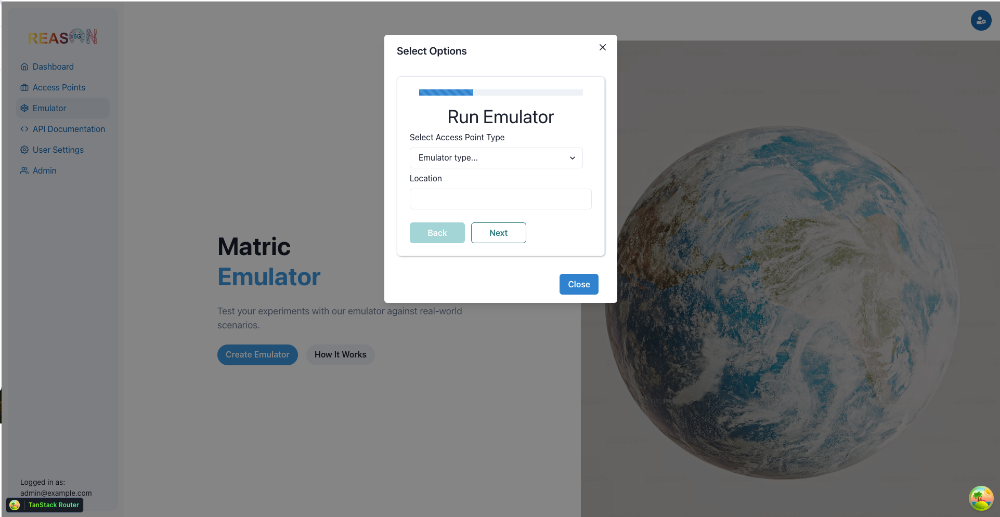
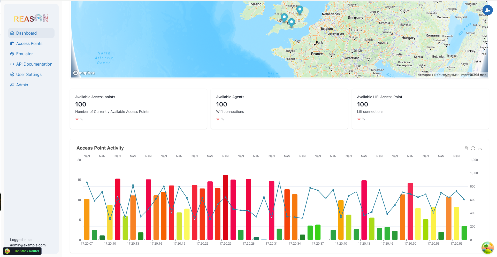
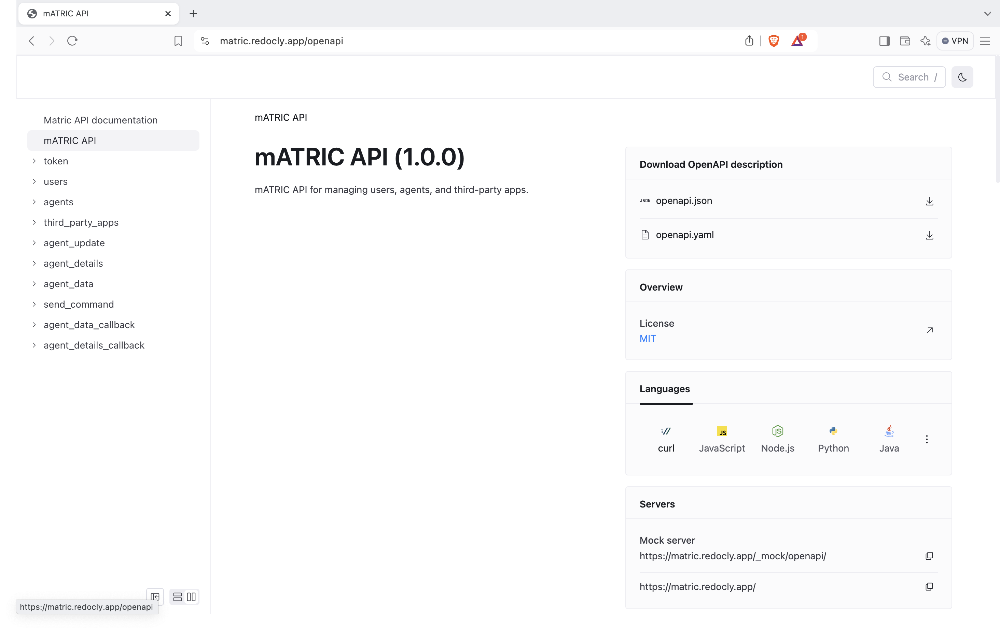

# Matric


mATRIC is multi-Access Technology Intelligent Controller

# Basic overview 
This repository host the mATRIC software implementation platform, an intelligent RAN controller developed under the [](https://reason-open-networks.ac.uk/about/) project to support multiple wireless access technologies.


**The mATRIC platform supports the following capabilities:**

- Real-time and near real-time scenarios.
- Cellular and non-cellular access technologies – _5G, WiFi, LiFi_.
- Monitoring, intelligence and data analytics.
- Control and optimisation of RAN resources.

<a href="https://github.com/tiangolo/full-stack-fastapi-template/actions?query=workflow%3ATest" target="_blank"></a>
<a href="https://coverage-badge.samuelcolvin.workers.dev/redirect/tiangolo/full-stack-fastapi-template" target="_blank"></a>

## Technology Stack and Features

- ⚡ [**FastAPI**](https://fastapi.tiangolo.com) for the Python backend API.
    - 🧰 [SQLModel](https://sqlmodel.tiangolo.com) for the Python SQL database interactions (ORM).
    - 🔍 [Pydantic](https://docs.pydantic.dev), used by FastAPI, for the data validation and settings management.
    - 💾 [PostgreSQL](https://www.postgresql.org) as the SQL database for User Management/Login.
    - 💽 [InfluxDB](https://www.influxdata.com) as the database for Access Point Management.
- 🚀 [React](https://react.dev) for the frontend.
    - 💃 Using TypeScript, hooks, Vite, and other parts of a modern frontend stack.
    - 🎨 [Chakra UI](https://chakra-ui.com) for the frontend components.
    - 🤖 An automatically generated frontend client.
    - 🦇 Dark mode support.
- 🐋 [Docker Compose](https://www.docker.com) for development and production.
- 🔒 Secure password hashing by default.
- 🔑 JWT (JSON Web Token) authentication.
- 📫 Email based password recovery.
- ✅ Tests with [Pytest](https://pytest.org).
- 📞 [Traefik](https://traefik.io) as a reverse proxy / load balancer.
- 🚢 Deployment instructions using Docker Compose, including how to set up a frontend Traefik proxy to handle automatic HTTPS certificates.
- 🏭 CI (continuous integration) and CD (continuous deployment) based on GitHub Actions.

### Dashboard Login

[](https://github.com/REASON-6G/mATRIC-master)

### Dashboard - Emulator

[](https://github.com/REASON-6G/mATRIC-master)

### Dashboard - Console

[](https://github.com/REASON-6G/mATRIC-master)

### Access Points Globe Search

[](https://github.com/REASON-6G/mATRIC-master)

### Interactive API Documentation

[](https://github.com/REASON-6G/mATRIC-master)

# mATRIC

A local, containerised dev stack for the mATRIC platform.

## Quick Start

### 1) Clone the repo
~~~bash
git clone git@github.com:mATRIC-Platforms/mATRIC-master.git
cd mATRIC-master
~~~

### 2) Start the stack

**If your Docker Compose supports `--wait`:**
~~~bash
docker compose up -d --build --wait
~~~

**If your Docker Compose does not support `--wait`:**
~~~bash
docker compose build
docker compose up -d mq db influxdb mailcatcher
until [ "$(docker inspect -f '{{.State.Health.Status}}' $(docker compose ps -q mq))" = "healthy" ]; do sleep 2; done
docker compose up -d backend agent agent_data agent_details agent_command frontend proxy adminer
~~~

## Endpoints & UI

- Swagger / OpenAPI: <http://127.0.0.1:8888/docs>
- Backend API root: <http://127.0.0.1:8888>
- Frontend: <http://localhost/login>
- InfluxDB: <http://localhost:8086/>

## InfluxDB Setup

Generate a token in the InfluxDB UI and set it in your `.env`:

~~~env
# InfluxDB
INFLUXDB_TOKEN=sometoken
~~~

After updating `.env`, restart the backend:

~~~bash
docker compose up -d backend
~~~

## Postgres (psql) Access

Run `psql` from the DB container:

~~~bash
docker compose run --rm db psql -a app -h db --username postgres
~~~

When prompted:
```
password: changethis
```

Useful `psql` commands:
```
\dt    -- list tables
\dn    -- list schemas
\du    -- list roles
\q     -- quit
```

## Troubleshooting

- If a service keeps restarting, check its logs:
~~~bash
docker compose logs -f SERVICE_NAME
~~~
- Ensure Docker/Compose is running and enough CPU/RAM is allocated.


## Backend Development

Backend docs: [backend/README.md](./backend/README.md).

## Frontend Development

Frontend docs: [frontend/README.md](./frontend/README.md).

## Deployment

Deployment docs: [deployment.md](./deployment.md).

## Development

General development docs: [development.md](./development.md).

This includes using Docker Compose, custom local domains, `.env` configurations, etc.

## License

Licensed under the terms of the BSD 3-Clause License
